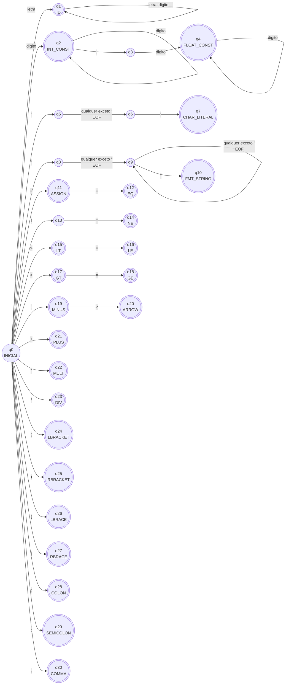

# AFD do analisador léxico

O analisador léxico é guiado por este autômato. Ele está implementado como uma tabela de transições `transicao[estado][classe]` em [src/lexico.c](../src/lexico.c), na função `construirAFD()`. O comando abaixo imprime a tabela que o programa realmente usa, então é possível conferir que o código e este diagrama são o mesmo autômato:

```bash
./compilador_p --afd
```

## Alfabeto (classes de caracteres)

Cada caractere da entrada é classificado antes de consultar a tabela:

| Classe | Caracteres |
|---|---|
| `letra` | `a`–`z`, `A`–`Z` |
| `digito` | `0`–`9` |
| `_ . ' " = ! < > - + * / ( ) { } : ; ,` | o próprio caractere |
| `espaco` | espaço, tabulação, `\r` |
| `\n` | quebra de linha |
| `outro` | qualquer outro caractere (por exemplo `@`, `#`, `%`, acentos) |
| `EOF` | fim da entrada |

## Diagrama

Estados com círculo duplo são de aceitação. O rótulo de cada estado de aceitação indica o token reconhecido.



## Tabela de estados

| Estado | Aceita | Transições |
|---|---|---|
| q0 INICIAL | — | ver diagrama |
| q1 ID | `ID` ou palavra reservada | letra, dígito, `_` → q1 |
| q2 INT | `INT_CONST` | dígito → q2; `.` → q3 |
| q3 FLOAT_PONTO | não | dígito → q4 |
| q4 FLOAT | `FLOAT_CONST` | dígito → q4 |
| q5 CHAR_ABRE | não | qualquer exceto `'`, `\n`, EOF → q6 |
| q6 CHAR_CONTEUDO | não | `'` → q7 |
| q7 CHAR | `CHAR_LITERAL` | — |
| q8 STR_ABRE | não | qualquer exceto `"`, `\n`, EOF → q9 |
| q9 STR_CONTEUDO | não | qualquer exceto `"`, `\n`, EOF → q9; `"` → q10 |
| q10 STR | `FMT_STRING` | — |
| q11 ASSIGN | `ASSIGN` | `=` → q12 |
| q12 EQ | `EQ` | — |
| q13 EXCLAMACAO | não | `=` → q14 |
| q14 NE | `NE` | — |
| q15 LT | `LT` | `=` → q16 |
| q16 LE | `LE` | — |
| q17 GT | `GT` | `=` → q18 |
| q18 GE | `GE` | — |
| q19 MINUS | `MINUS` | `>` → q20 |
| q20 ARROW | `ARROW` | — |
| q21–q30 | `PLUS`, `MULT`, `DIV`, `LBRACKET`, `RBRACKET`, `LBRACE`, `RBRACE`, `COLON`, `SEMICOLON`, `COMMA` | — |

Qualquer par (estado, classe) que não aparece na tabela não tem transição.

## Como o AFD é usado

1. Espaços e quebras de linha entre lexemas são descartados, e o contador de linhas é atualizado.
2. O AFD parte de q0 e segue as transições enquanto existirem (lexema mais longo).
3. Se parar em um estado de aceitação, o lexema vira um token. No estado q1, o lexema é comparado com a lista de palavras reservadas (`fn`, `main`, `let`, `int`, `float`, `char`, `if`, `else`, `while`, `println`, `return`), e o token passa a ser o da palavra reservada.
4. Se parar em um estado que não é de aceitação, é um erro léxico. A mensagem depende do estado em que o AFD parou:

| Estado de parada | Erro relatado | Exemplo |
|---|---|---|
| q0 | caractere inválido | `@`, `#`, `_abc` |
| q3 | constante float mal formada | `12.` |
| q5 | literal de caractere vazio ou não terminado | `''` |
| q6 | literal com mais de um caractere ou não terminado | `'ab'` |
| q8 | string de formatação vazia ou não terminada | `""` |
| q9 | string de formatação não terminada | `"sem fim` |
| q13 | `!` isolado | `x ! 3` |

O lexema com erro não entra no vetor de tokens, e a análise continua logo depois dele. Assim, todos os erros léxicos do arquivo são encontrados em uma única execução.
